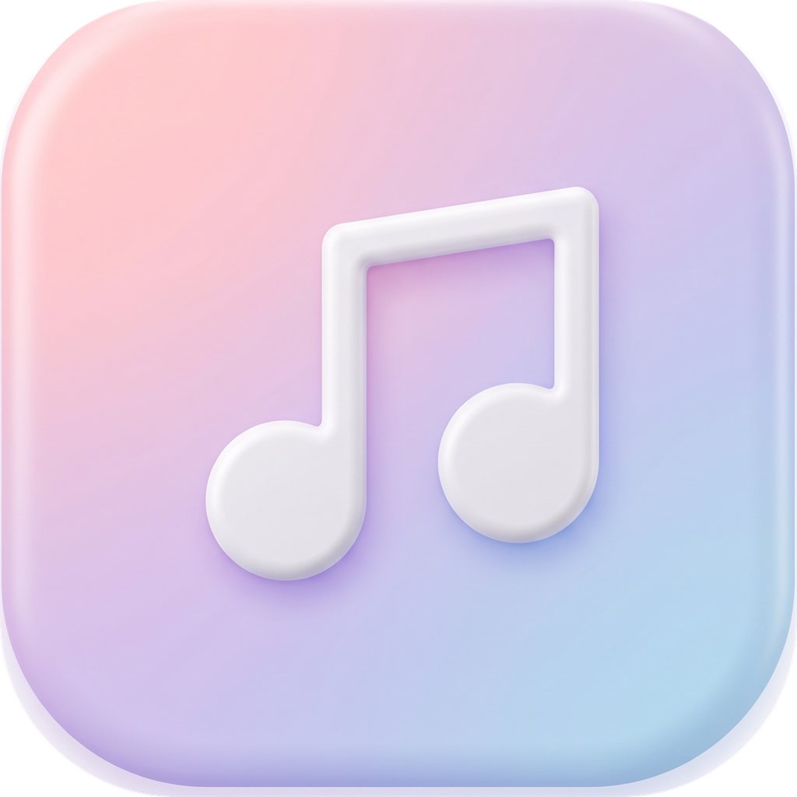

<div align="center">
  

  <h1>HuayuanMusic</h1>

  <p>
    <a href="https://dotnet.microsoft.com"></a>
    <a href="LICENSE"></a>
    <a href="#"></a>
    <a href="#"></a>
  </p>

  <p>
    <a href="#本地构建">本地构建</a>
    ·
    <a href="#架构">可插拔 DLC 架构</a>
    ·
    <a href="#免责声明">免责声明</a>
  </p>
</div>

> 一款面向 Windows 的粉蓝白液态玻璃风格桌面音乐播放器。基于 .NET 10 与 Avalonia 构建，追求轻盈、顺滑、完整的桌面听歌体验。

---

## 软件亮点

- **粉蓝白液态玻璃（Liquid Glass）**：全站统一的粉蓝白渐变氛围与白瓷玻璃质感，配合程序化折射与微动效，呈现柔和通透的现代视觉。
- **上提居中的自适应双语歌词**：完整歌词视图自动上提并居中，中文与原文歌词双语对照，逐字高亮与进度动画流畅同步。
- **保留原色调的单行滚动桌面歌词**：桌面歌词浮窗保留歌词原始色调，单行滚动展示，支持鼠标穿透、锁定与位置记忆。
- **`1 : 1.5 : 1` 播控坞**：比例协调的播放控制坞，搭配完整的队列数字胶囊，播放状态一目了然。
- **三端三态标准格式下载**：统一的歌曲下载体验，标准格式、进度可控。
- **系统托盘与单实例唤醒**：最小化到托盘、托盘菜单控制，重复启动自动唤醒已开窗口。
- **Windows SMTC 集成**：接入系统媒体传输控制（SMTC），锁屏/媒体键可控播放。
- **可插拔 DLC 启停闭环**：平台能力以 DLC 形式可插拔接入，支持独立启停与完整卸载。

## 粉蓝白液态玻璃特性

HuayuanMusic 的核心视觉由一套共享的程序化氛围系统驱动：

- **粉蓝白渐变氛围**：左上粉、右下蓝、中央柔白的三向渐变场，随浅色/深色主题自动切换明度。
- **白瓷玻璃质感**：玻璃面板通过程序化折射采样 + 磨砂（frost）混合，边缘高光与斜切 bevel 呈现白瓷般的通透感。
- **微动效**：按钮、面板与播控坞在交互时带平滑的缩放/位移动效，减少生硬跳变。

## 架构

### 可插拔 DLC 架构

HuayuanMusic 采用「核心 + DLC」的可插拔设计，将平台能力与主程序解耦：

- **核心（Core）**：本地音乐库、播放队列、BASS 音频核心、HTTP 206 媒体网关与桌面歌词等基础能力，始终随主程序运行。
- **DLC（平台扩展）**：酷狗概念版等平台接入以独立 DLC 形式存在，支持动态启停、独立授权与完整卸载，不影响核心本地播放。
- **媒体代理网关**：`DirectSdkGateway` / `DirectSdkGateway.MediaProxy` 负责 HTTP 206 分片拉流与 BASS 音频解码，保证在线播放的流畅与可控。

### 自动更新

主程序内置零依赖的 GitHub Releases 更新检测（使用 .NET 原生 `HttpClient` 与 `System.Text.Json`，不引入任何第三方更新组件）：

- 启动后后台静默检查最新版本，网络不可用或未发布时静默忽略，绝不打扰听歌。
- 设置页提供「检查更新」按钮，手动触发并展示当前版本。
- 发现新版本时弹出粉蓝白玻璃更新弹窗，一键下载安装包并静默升级、自动重启。

## 本地构建

### 前置条件

- Windows 10 19041+ / Windows 11
- .NET 10 SDK
- （可选）Inno Setup 6，用于生成一键安装包

### 构建步骤

```powershell
# 一键构建：生成透明圆角图标 → 离线自包含 Release 发布 → （可选）Inno Setup 打包
.\app-m223\bundle.ps1
```

产物输出到 `app-m223/artifacts/release-build/`：

- `app/` —— 自包含 Release 可执行目录，主程序为 `HuayuanMusic.P17.Nightflight.exe`
- `HuayuanMusic-Setup-v1.0.0.exe` —— Inno Setup 一键安装包（需本机已安装 Inno Setup 6）

也可以手动分步执行：

```powershell
# 1. 生成透明圆角图标
.\app-m223\tools\Build-AppIcon.ps1

# 2. 编译（离线锁定模式）
dotnet publish app-m223/src/Preview.csproj -c Release -r win-x64 --self-contained true --locked-mode -o app-m223/artifacts/release-build/app

# 3. 打包（可选）
& "C:\Program Files (x86)\Inno Setup 6\ISCC.exe" app-m223/installer.iss
```

### 首次运行 Windows SmartScreen 提示

本程序当前未做代码签名证书，首次运行时 Windows SmartScreen 可能弹出「已保护你的电脑」提示。这是未签名程序的正常现象，请按以下步骤放行：

1. 点击提示框中的「更多信息」。
2. 点击「仍要运行」。
3. 之后即可正常启动。

用户音乐数据（下载歌曲、自建歌单、播放历史）保存在 `%USERPROFILE%\Music\HuayuanMusic`，升级或卸载均不会误删。

## 第三方组件与致谢

- **BASS / ManagedBass**：音频解码与播放核心，遵循其**非商业免费授权**。若用于商业用途，请自行向 un4seen 购买授权。
- **Avalonia**：跨平台 UI 框架（MIT License）。
- **.NET**：微软开源运行时（MIT License）。
- 本项目源自对开源酷狗音乐概念版播放器（KA Music，MIT License，Copyright (c) 2026 Linsxyx）的学习与重构，特此致谢。

## 免责声明 / Disclaimer

**中文**

本项目是基于公开接口开发的第三方音乐客户端，仅供个人学习与技术研究使用。

- **数据来源**：音乐数据通过公开接口获取，本项目不存储、不传播任何音频文件。
- **版权声明**：音乐内容版权归原平台及版权方所有，请尊重知识产权，支持正版音乐。
- **使用限制**：禁止将本项目用于任何商业用途或违法行为。
- **责任声明**：因使用本项目产生的任何法律纠纷或损失，均由使用者自行承担。
- **BASS 授权**：本项目中的 BASS 组件遵循其非商业免费授权，商业使用须另行取得授权。

**English**

This is a third-party music client built on public APIs, intended for personal study and technical research only.

- **Data source**: Music data is fetched through public interfaces; this project does not store or distribute any audio files.
- **Copyright**: Music content belongs to its original platform and rights holders. Please respect intellectual property and support legitimate music.
- **Usage restriction**: Commercial use or any illegal activity is prohibited.
- **Liability**: The user bears sole responsibility for any legal disputes or losses arising from the use of this project.
- **BASS license**: The BASS component is used under its free non-commercial license; commercial use requires a separate license.

## License

本项目主体采用 [MIT License](LICENSE)，第三方组件遵循其各自的许可证，详见 LICENSE 中的第三方组件声明。
